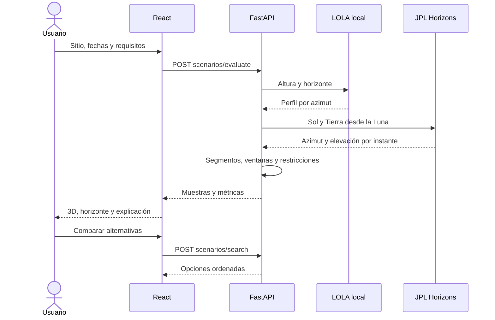

> Documento de un corte historico. Para el estado actual consultar [Estado vigente](14-estado-y-pendientes.md) y [Registro de entregas](15-registro-de-entregas.md).

# Flujo del sistema

[Índice](README.md) · [Arquitectura](03-arquitectura.md)

## 1. Abrir el explorador

`frontend/src/main.tsx` monta `App.tsx`. La interfaz consulta `/api/v1/sites` y `/api/v1/status`. La primera respuesta carga un catálogo estático del backend; la segunda indica si el DEM está instalado. No es una prueba en vivo de disponibilidad de todos los servicios NASA.

El visor descarga `/luna/luna_cientifica.glb` desde el frontend. **En este commit no descarga teselas Moon Trek para dibujar el globo.** Los adaptadores WMTS permanecen disponibles en el backend.

## 2. Elegir dónde explorar

Hay tres caminos: seleccionar un sitio del catálogo, introducir coordenadas o Mayús + clic sobre el globo/terreno. La UI acepta puntos al sur de 75° S; después el lector DEM verifica cobertura real. Una coordenada dentro de ese rango no garantiza que todos los rayos del horizonte permanezcan en cobertura.

La selección borra el análisis anterior y pide `/api/v1/terrain/mesh`. El backend muestrea el mismo LOLA de 240 m usado por el horizonte. La UI solicita una cuadrícula de 65 × 65 puntos y radio de 25 km. El espaciado aproximado de la malla visual es 50 km / 64 = **781,25 m**: no confundirlo con el píxel de 240 m del producto original.

## 3. Configurar el escenario

El usuario define fecha UTC, periodo de 1/3/7/14 días, paso temporal, duración simultánea necesaria y mínimos de iluminación/Tierra visible. También puede cambiar la distancia de trazado del horizonte.

El escenario normal solicita horizonte DEM y observador a **2 m** sobre el terreno. El frontend limita ciertas combinaciones de periodo y paso para respetar el máximo de muestras del backend. Cambiar controles no transforma por sí solo un resultado previo: hay que ejecutar otra consulta, y el resultado conserva sus fechas originales.

## 4. Analizar un sitio

`POST /api/v1/scenarios/evaluate` recibe el escenario. El backend valida tiempos y parámetros, calcula o reutiliza el perfil de horizonte, obtiene la altura del sitio y consulta Horizons para el Sol (10) y la Tierra (399).

Para cada muestra compara la elevación del centro del cuerpo con el horizonte en su azimut. Construye segmentos temporales, ventanas, porcentajes, interrupciones y cumplimiento. La fracción del disco parcialmente visible se calcula y se expone por separado.

Si falta DEM se devuelve 503; cobertura insuficiente produce 422; fallos de Horizons, 502. La interfaz principal no sustituye esos fallos por una demo.

## 5. Recorrer el tiempo y el 3D

El cursor y la reproducción eligen una muestra. Las flechas usan el azimut/elevación real recibido y una base local norte/este/arriba. Tamaños y distancias de los cuerpos son simbólicos.

Globo y malla son objetos diferentes. La vista local representa alturas del DEM, pero la auditoría encontró que el origen del marcador/flechas continúa ligado al GLB y a un desplazamiento visual. No tratar la cámara como posición física certificada del observador: [hallazgo A02](07-auditoria.md#a02-p1-origen-visual-distinto-del-observador-fisico).

`HorizonPanel` consulta el perfil y ubica Sol/Tierra sobre él. Las lecturas numéricas declaran elevación del cuerpo, elevación del horizonte y fracción del disco.

## 6. Comparar lugares y fechas

Las casillas eligen hasta tres sitios. `/api/v1/scenarios/search` evalúa la fecha inicial y, opcionalmente, inicios a +3 y +7 días. Se conserva la duración y las restricciones.

Orden: primero cumplimiento, después mayor duración simultánea continua y finalmente fracción simultánea. Si las métricas empatan, el orden de entrada se conserva. La búsqueda no cubre todas las fechas ni optimiza una trayectoria de aterrizaje.

`ResultsPanel` presenta las alternativas. Seleccionar una llama a `openOption`, cambia el punto, carga sus resultados y sincroniza el visor. Este camino es distinto del endpoint `/scenarios/rank`, cuyo problema de priorización se documenta en la auditoría.

## 7. Exportar y entender

El botón CSV del frontend exporta muestras, ángulos, horizonte y estados. Hay también una exportación backend con más columnas. **Ninguna conserva todavía toda la procedencia e incertidumbre prometida en el plan del equipo.** La guía y «Datos y método» explican conceptos; no sustituyen metadatos completos en cada exportación.

## Secuencia principal

