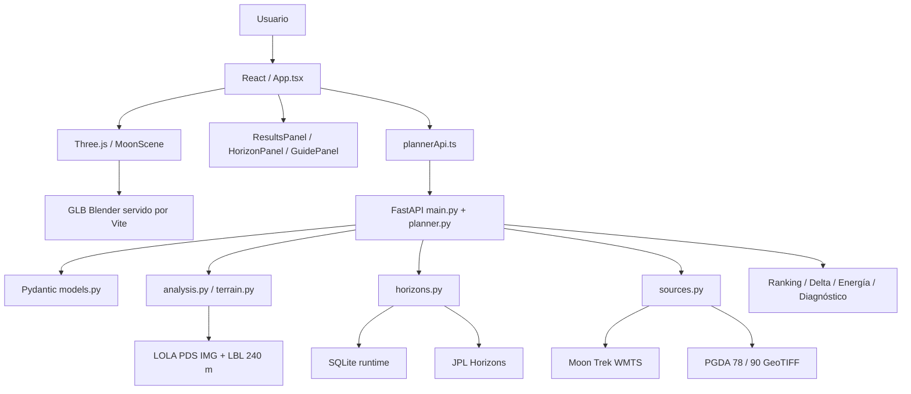

> Documento de un corte historico. Para el estado actual consultar [Estado vigente](14-estado-y-pendientes.md) y [Registro de entregas](15-registro-de-entregas.md).

# Arquitectura actual

[Índice](README.md) · [Contratos](04-apis-y-contratos.md)

## Frontend

| Archivo o carpeta | Responsabilidad |
| --- | --- |
| `frontend/src/main.tsx` | Montar React y estilos. |
| `frontend/src/App.tsx` | Estado del escenario, solicitudes, navegación y coordinación. |
| `frontend/src/plannerApi.ts` | Tipos del cliente, fetch y presentación UTC. |
| `frontend/src/MoonScene.tsx` | WebGL, carga GLB, cámara, raycasting, malla y flechas. |
| `frontend/src/features/insights/` | Resultados, horizonte y guía recibidos por props. |
| `frontend/src/explorer.css` | Estilos principales del explorador. |
| `frontend/src/LegacyApp.tsx`, `data.ts`, `api.ts` | Interfaz anterior y código demo conservado; no es el flujo principal. |

`request<T>` usa una conversión de tipos TypeScript, no una validación completa de JSON en ejecución. El contrato debe verificarse entre ambos equipos; los campos nuevos del backend no aparecen automáticamente en la UI.

## Backend

| Módulo | Responsabilidad |
| --- | --- |
| `main.py` | Ciclo de vida, DEM/cache, CORS, endpoints históricos y evaluación central. |
| `planner.py` | Adaptadores del explorador, malla, búsqueda de fechas y recomendación. |
| `models.py` | Contratos Pydantic y validación. |
| `terrain.py` | Lectura mmap de IMG/etiqueta PDS, proyección y rayos; caché LRU del horizonte. |
| `horizons.py` | Consulta y parseo de efemérides. |
| `analysis.py` | Horizonte interpolado por azimut, exposición parcial, segmentos y métricas. |
| `transitions.py` | Resolución efectiva y límites del refinamiento. |
| `cache.py` | Caché SQLite de efemérides; redondea parte de la clave. |
| `sources.py` | Descubrimiento WMTS/PGDA y lectura puntual GeoTIFF. |
| `catalog.py` | Catálogo escrito en código, no descarga dinámica NASA. |
| `ranking.py`, `delta.py`, `power.py`, `copilot.py` | Funciones adicionales. Diagnóstico y extracción de restricciones por reglas, no LLM. |

Los cálculos DEM costosos se envían a un threadpool. El acceso HTTP NASA usa un cliente compartido. Hay límites por escenario y búsqueda, pero no un sistema de trabajos persistentes, seguimiento de progreso o cancelación completa del trabajo ya iniciado.

## Persistencia y despliegue

- El DEM se descarga a `backend/data`; no se versiona la imagen binaria.
- SQLite runtime conserva efemérides y está ignorado por Git.
- El GLB de unos 10,9 MB sí está versionado y se entrega como asset frontend.
- Catálogos/capacidades y teselas tienen caché en memoria; el horizonte tiene LRU por proceso.
- No hay cuentas, permisos por usuario, base de proyectos ni despliegue cloud en este alcance.
- Vite reenvía `/api` al backend local. CORS se configura por entorno.

## Límites de responsabilidad

Blender representa la Luna; no debe reemplazar la topografía científica del cálculo. Moon Trek sirve cartografía; no calcula nuestras recomendaciones. Horizons calcula geometría; no conoce automáticamente nuestro perfil de relieve. El motor propio combina los datos.

El cambio a Blender dejó servicios Moon Trek disponibles, pero fuera del camino de dibujo actual. Su atribución y georreferenciación deben verificarse por separado. El nombre «MOON_ME» en una etiqueta no demuestra esa transformación.

## Trabajo paralelo acordado

La otra IA recibió propiedad exclusiva de `frontend/src/features/insights/`. La integración principal quedó a cargo de backend, `App.tsx`, `MoonScene.tsx`, `plannerApi.ts` y estilos generales. Los componentes de Insights no realizan fetch ni controlan el visor; reciben datos y callbacks. Esta separación permitió integrarlos sin escribir simultáneamente los mismos archivos.
