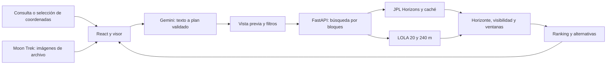

# Estado vigente y pendientes

Actualizado el 15 de noviembre de 2026. Base científica/generativa: `b551128`; la evolución posterior de interfaz se describe aquí y en el registro de entregas. Complementa y reemplaza afirmaciones de estado antiguas de las páginas 01–11. Este documento se actualiza con cada entrega relevante. No contiene secretos ni depende del historial del chat.

## Qué funciona

| Área | Comportamiento actual | Módulos principales |
| --- | --- | --- |
| Interfaz | Selección, coordenadas manuales, análisis, comparación, resultados y fuentes en español. Sin métricas de reserva cuando falla la API. | `frontend/src/App.tsx`, `plannerApi.ts`, `features/insights/` |
| Explicación visual | «Datos y método» comienza con tres diagramas: coordenada/fecha, posiciones frente al relieve y ventanas simultáneas. Ejemplo interactivo de Sol oculto/visible, rotulado como ilustración. | `MethodExplainer.tsx`, `method-explainer.css`; ver [detalle y evidencia](16-explicacion-visual-del-metodo.md) |
| Globo | Luna Blender GLB, direcciones reales de Sol/Tierra y modelos de esos cuerpos; distancias/tamaños visuales simbólicos. | `frontend/src/MoonScene.tsx`, `frontend/public/luna/`, `sol/`, `tierra/` |
| Escena local y luz | Baliza anclada al observador; Sol/Tierra ampliados; luz entrante y vista saliente diferenciadas; sombras de malla con dirección solar Horizons; enfoque y movimiento reducido. Malla/etiquetas alineadas con fuente DEM fina. | `MoonScene.tsx`, `scene-clarity.css`, `App.tsx`; [pruebas y límites](19-escena-3d-observador-luz-y-sombras.md) |
| Mapa | Moon Trek polar, NAC/LOLA, paneo, escala, cursor, zoom, selección y marcadores de consultas. Imágenes de archivo, no sombras de la fecha. | `SurfaceMap.tsx`, `LocalTileMap.tsx`, `moontrek.ts`, `polar.ts` |
| Consulta sobre el mapa | La propuesta encuadra candidatos numerados y contorno regional; comparar desde el mapa, seleccionar sin duplicados y abrir una propuesta o resultado centran su coordenada. Filtros y coordenadas en detalle desplegable. | `AssistantSearch.tsx`, `App.tsx`, `SurfaceMap.tsx`, `queryMapGeometry.ts`; [detalle y prueba real](17-consulta-interactiva-en-mapa.md) |
| Efemérides | NASA/JPL Horizons para Sol y Tierra, caché SQLite con coordenadas exactas, intervalos validados. | `backend/app/horizons.py`, `cache.py`, `main.py` |
| Horizonte | DEM 20 m cercano hasta 5 km con cobertura completa; 240 m lejano hasta distancia solicitada. Mismo origen físico DEM + altura del observador. Fuente/distancia dominante por azimut. | `backend/app/terrain.py` |
| Relieve y pendiente | Malla fina o gruesa según cobertura; fuente y resolución explícitas. Pendiente regional de 240 m, no escala del vehículo. | `backend/app/planner.py`, `mesh.py`, `slope.py` |
| Comparación | Condiciones, ventanas simultáneas, oscuridad y falta de visibilidad; separación entre incumplimiento y datos no disponibles. Ranking prioriza cumplimiento; sin ganador si ninguno cumple. | `analysis.py`, `ranking.py`, `planner.py` |
| Resultados visuales y ceros | Anillos, elevación frente al horizonte y pistas temporales reales explican la ocultación. Auditoría con Horizons sin caché, SPICE y trazado independiente confirmó ceros y controles positivos; no se fuerzan porcentajes. | `VisibilityVisuals.tsx`, `visibility-visuals.css`, `scripts/verify_zero_visibility.py`; [auditoría y evidencia](18-verificacion-de-ceros-y-resultados-visuales.md) |
| Sensibilidad | Centro y cuatro vecinos, rangos deterministas y cobertura. No intervalo estadístico de confianza. | `/scenarios/sensitivity` |
| Consultas | Gemini produce JSON validado y una vista previa. La búsqueda usa el motor NASA, conserva filtros y muestra alternativas. | `backend/app/generative.py`, `frontend/src/AssistantSearch.tsx` |
| Ideas de consulta | Tres ejemplos editables: coordenadas propias, candidatos nuevos y dos fechas de un mes. Completan el campo sin consultas automáticas. Proximidad entre pares no es un criterio implementado. | `AssistantSearch.tsx`, `assistant-examples.css`; [detalle](13-consultas-generativas.md) |
| Puntos nuevos | Región con centro, radio de 1–100 km y 3/9 candidatos geodésicos. Coordenadas explícitas y catálogo también disponibles. | `ExplorationRegion`, `SearchPlan` en `generative.py` |
| Meses | Hasta 31 inicios diarios y 14 días por escenario; ejecución por bloques. `top_k` muestra 1–10 resultados; modo `dates` selecciona fechas distintas. | `SearchPlan`, `execute` en `generative.py` |
| Recursos NASA adicionales | Moon Trek WMTS y catálogos/elevación PGDA 78/90. No todos son insumos de cada resultado; Horizons y LOLA son los del cálculo operativo. | `backend/app/sources.py`, `planner.py` |

## Arquitectura y límites que no deben romperse



- `/api/v1/scenarios/search` conserva el contrato de hasta tres puntos por lote, siete días adicionales de inicio y 14 días combinados. El asistente lo reutiliza por bloques; no confundir sus límites con los de la consulta completa.
- La comparación manual selecciona hasta tres puntos. La exploración del asistente puede evaluar nueve; todos sus candidatos se conservan como marcadores, y el conjunto manual sigue acotado.
- Escenario científico: UTC con offset, intervalo `[inicio, fin)`, hasta 14 días y 500 pasos. El asistente fija paso de 60 min, observador a 2 m y horizonte a 250 km.
- Marco terreno `MOON_ME_DE421`, radio 1.737.400 m; coordenadas en grados, alturas y distancias con unidades explícitas. El kernel del servicio Horizons es controlado por el proveedor, no fijado por el cliente.
- DEM de 20 m al sur de 87,5° S, sujeto a cobertura completa de la operación; cobertura operativa gruesa desde 75° S. El GLB es visual y no sustituye al DEM científico.
- Una `clarification` impide ejecutar. La UI oculta puntos/supuestos de una consulta no resuelta. `alternative_query` solo se adopta al elegirla el usuario.
- El ranking no demuestra un óptimo global; respeta empates. Luz ≠ energía y línea de vista ≠ capacidad física del enlace.

## Rutas para ubicar una tarea

Todas llevan prefijo `/api/v1`, salvo `/health`.

| Ruta | Contrato/responsabilidad |
| --- | --- |
| `GET /sites`, `/sites/{id}` | Catálogo; no limita el universo de puntos personalizados. |
| `POST /ephemeris` | Posiciones del Sol/Tierra, cuerpos y fechas validados. |
| `POST /terrain/horizon`, `/terrain/mesh`, `/terrain/grid`, `/terrain/slope` | Perfil, malla del visor, contrato de malla de Elkin y pendiente regional. |
| `POST /scenarios/evaluate`, `/scenarios/search`, `/scenarios/recommend`, `/scenarios/sensitivity` | Motor y comparaciones existentes. |
| `GET /maps/layers`, `GET /terrain/products/{78 o 90}` | Fuentes adicionales y catálogos. |
| `GET /assistant/status` | Indica presencia de configuración; no prueba credenciales. |
| `POST /assistant/plan` | `text`, `reference_date`, `current_site` opcional → `plan`, `points`, `scope`. No calcula métricas. |
| `POST /assistant/search` | `SearchPlan` → alternativas, `evaluated_count`, `requested_count`, errores, puntos y resumen calculado. |

`SearchPlan`: `start_date`, `duration_days`, `search_days` (0–30), `constraints`, `site_ids`/`coordinates` **o** `region`; `top_k`, `result_mode`, `assumptions`, `clarification`, `alternative_query`. Noviembre completo: inicio el día 1 y `search_days=29`. La duración por escenario no es la duración del barrido.

## Arranque de una copia nueva

Raíz del proyecto, PowerShell, Python 3.12:

```powershell
cd backend
python -m venv .venv
.venv/Scripts/python -m pip install -e ".[dev]"
.venv/Scripts/python scripts/download_lola.py --highres
# Crear .env usando .env.example; conservar un .env existente.
.venv/Scripts/python -m uvicorn app.main:app --host 127.0.0.1 --port 8000
```

En otra terminal:

```powershell
cd frontend
npm ci
npm run dev -- --port 5174
```

Frontend: `http://127.0.0.1:5174`; Swagger: `http://127.0.0.1:8000/docs`. Vite reenvía `/api` al puerto 8000. Reservar 5174 porque en el entorno original 5173 pertenecía a otro proyecto.

Gemini requiere `GEMINI_API_KEY` únicamente en `backend/.env`; modelo verificado `GEMINI_MODEL=gemini-3.1-flash-lite`. Reiniciar backend y recargar UI tras configurarlo. La clave se configuró y probó localmente, **no está en Git**. Otra máquina debe suministrar su configuración privada. NASA no requiere esa clave.

IMG, kernels binarios, SQLite, dependencias y `.env` se excluyen de Git. Descargar DEM en la máquina nueva. Los GLB sí están versionados. Para validación independiente opcional, instalar `.[validation]` y usar `scripts/download_validation_kernels.py`; los scripts `validate_spice.py`/`validate_highres.py` requieren `PYTHONPATH=.` desde backend. No sobrescribir evidencia de una versión histórica con resultados nuevos.

## Evidencia y reproducción

| Verificación ejecutada | Resultado y alcance | Evidencia |
| --- | --- | --- |
| Backend | 59 pruebas aprobadas; incluye fixtures sintéticos, contratos, energía, ranking, caché y barrido mensual sin huecos. | `backend/tests/` |
| Build frontend | Correcto; advertencia de paquete JS de unos 961 kB pendiente de optimización. | `npm run build` |
| Consulta original en navegador | Gemini autenticado, seis alternativas NASA, selección y marcador, sin errores JS ni desbordamiento móvil. | [Informe](../docs/VALIDACION_ASISTENTE_NAVEGADOR_REAL.json) |
| Puntos generados en navegador | Gemini autenticado, tres candidatos nuevos, dos opciones, selección y marcador. | [Informe](../docs/VALIDACION_PUNTOS_NAVEGADOR_REAL.json) |
| Noviembre completo | Tres puntos nuevos × 30 fechas = 90 evaluaciones reales, cero fallos y dos fechas distintas. Caché de efemérides permitida. | [Informe](../docs/VALIDACION_EXPLORACION_GENERATIVA.json) |
| Contratos Gemini | Coordenadas/filtros conservados; combustible y periodo excesivo solicitan aclaración. | [Informe](../docs/VALIDACION_ASISTENTE_REAL.json) |
| Fallos del navegador | Cuatro fallos simulados: backend, evaluación, malla y Blender. No son caídas reales de NASA. | `frontend/tests/failure-cases.mjs` |
| Datos integrados | Malla 20 m de 10.201 puntos, metadatos, comparación, sensibilidad y 336 capas de catálogo. | [Informe](../docs/VALIDACION_INTEGRACION_REAL.json) |
| Validación independiente | Comparación de posiciones SPICE/INPOP y diferencias entre resoluciones. No valida ventanas completas sobre terreno. | [SPICE](../docs/VALIDACION_SPICE.json), [DEM](../docs/VALIDACION_DEM_20M.json) |

```powershell
# Desde backend
.venv/Scripts/python -m pytest -q
.venv/Scripts/python scripts/verify_integrated.py
.venv/Scripts/python scripts/verify_assistant_live.py
# Desde frontend, con ambos servidores funcionando para las E2E
npm run build
node tests/assistant.e2e.mjs
node tests/assistant.e2e.mjs --live
node tests/assistant.e2e.mjs --generated
node tests/failure-cases.mjs
# Desde raíz
python scripts/validate_wiki.py
```

Las pruebas `--live`/`--generated` consumen Gemini real y requieren clave/cuota. La prueba sin bandera simula solo la interpretación y usa la API científica local. La cobertura de esta muestra no garantiza que cualquier consulta se interprete bien.

## Pendientes priorizados

| Prioridad | Trabajo pendiente | Criterio de aceptación propuesto |
| --- | --- | --- |
| Alta | Validar ventanas completas con implementación independiente. | Comparar eventos/duraciones y registrar kernels, DEM, marco, paso y tolerancias; no solo posiciones. |
| Alta | Mejorar búsqueda espacial y temporal. | Muestreo/adaptación más denso y refinamiento de las mejores ventanas; mostrar alcance, empates y sensibilidad. Hoy solo centro/vecinos y fechas diarias. |
| Alta | Propagar incertidumbre a recomendaciones. | Mostrar rangos de transiciones y comparaciones; no declarar ganador si diferencias están dentro de variabilidad. |
| Media | Misiones y recursos configurables. | Perfiles de generación, batería, carga y enlace conectados con ventanas; pruebas de balances. El integrador de energía fue corregido, no validado como vehículo real. |
| Media | Rendimiento y búsquedas largas. | Trabajos con progreso/cancelación, límites y medición en equipos modestos; dividir el paquete del visor y medir FPS/memoria. |
| Media | Calidad de interpretación. | Ampliar corpus con ambigüedad, meses, regiones, fechas y objetivos no soportados; errores claros, filtros visibles y pruebas reales con presupuesto. |
| Media | Resolución local y texturas. | NAC georreferenciada con cobertura/procedencia; separar resolución de textura y DEM. Relieve actual no resuelve obstáculos de escala del vehículo. |
| Nuevo alcance | Órbitas, transferencia o lanzamiento de satélite. | Definir cuerpo/estado inicial, órbita objetivo, fecha, propagación/dinámica y validación independiente antes de recomendar una maniobra. No implementado. |

No hay despliegue público acreditado por estas entregas. Publicar en GitHub no equivale a desplegar una aplicación ni a instalar datos y claves en otra máquina.
